# Salesforce Projects: Healthcare Appointment Management and Loan Eligibility

A Salesforce app that manages doctors, patients, appointments and prescriptions, with automation to prevent double-booking and to notify patients.

## Problem it solves
Clinics lose time to double-booked doctors and missed appointments. This app blocks clashes automatically, confirms bookings by email, sends daily reminders, and gives staff a live dashboard.

## Features
- **Data model:** Doctor, Patient, Appointment, Prescription (Lookup and Master-Detail relationships)
- **Validation rules:** no past appointments; a reason is required when cancelling
- **Apex trigger (bulkified):** blocks a doctor from being booked twice at the same time
- **Record-triggered Flow:** emails the patient when an appointment becomes Confirmed
- **Batch + Scheduled Apex:** emails reminders every day for tomorrow's appointments
- **Lightning Web Component:** dashboard of upcoming appointments with a status filter
- **Security:** Doctor Access permission set, tested by logging in as a test user

## Tech used
Apex, SOQL, Triggers, Batch and Schedulable Apex, Flow, Lightning Web Components, Validation Rules, Permission Sets, Salesforce CLI, VS Code, Git

## Quality
- 10 Apex tests, 100% pass rate, 96% org-wide coverage
- No SOQL in loops; one trigger per object with a handler class

## Screenshots

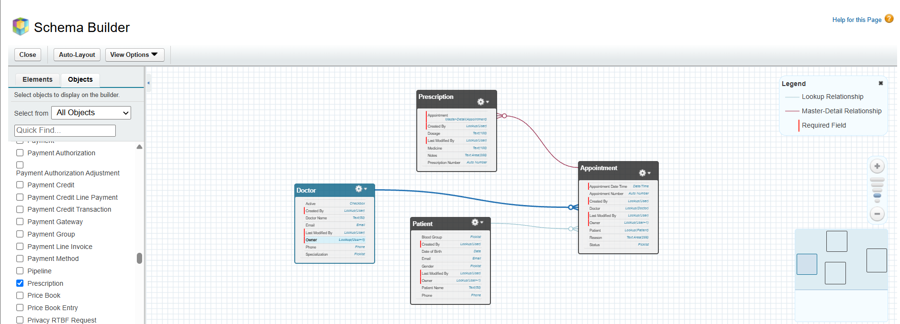

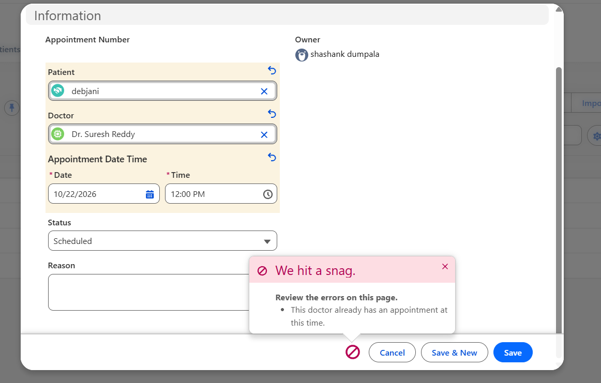

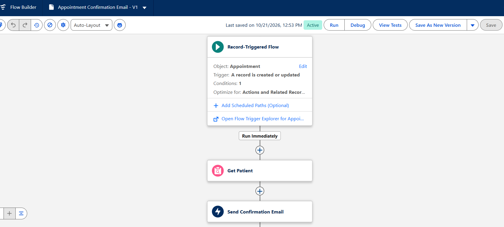

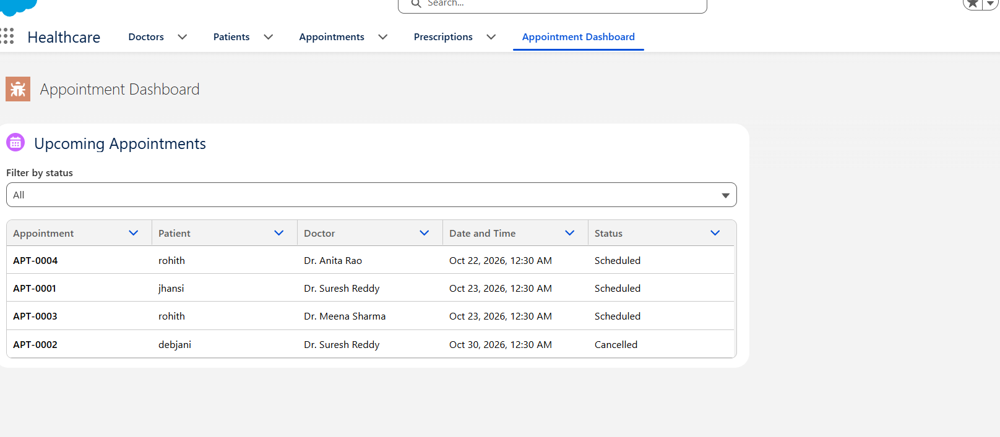

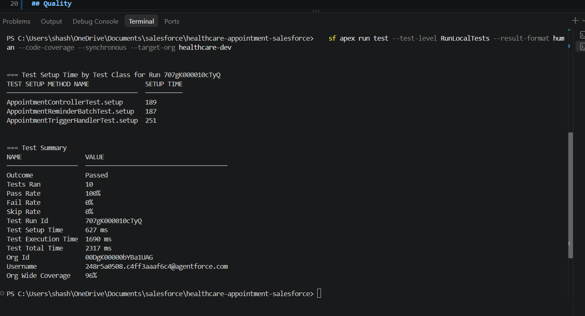

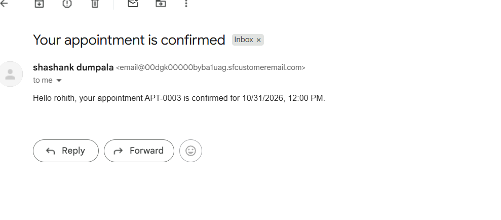

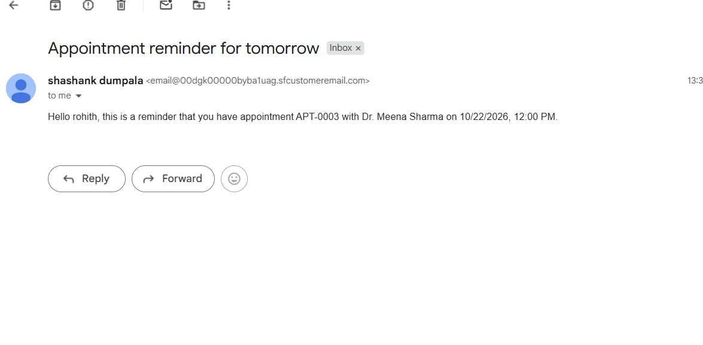

## Setup
1. Create a free Salesforce Developer Edition org.
2. Clone this repo and open it in VS Code with the Salesforce Extension Pack.
3. Authorize your org: `sf org login web --alias healthcare-dev`
4. Deploy: `sf project deploy start --source-dir force-app --target-org healthcare-dev`
5. Run tests: `sf apex run test --test-level RunLocalTests --synchronous --target-org healthcare-dev`
6. Assign the **Doctor Access** permission set and add the dashboard page to the Healthcare app.

## Project 2: Loan Application Eligibility and Approval
A bulkified Apex trigger scores each loan from income and loan amount. Small loans with a good score are approved, low scores are rejected, and loans above 500000 go to a manager approval process.

- Validation rule: loan amount must be greater than zero
- Approval process with final actions that set the status to Approved or Rejected
- 5 Apex tests, including a 200-record bulk test

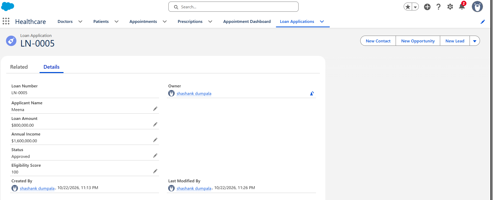

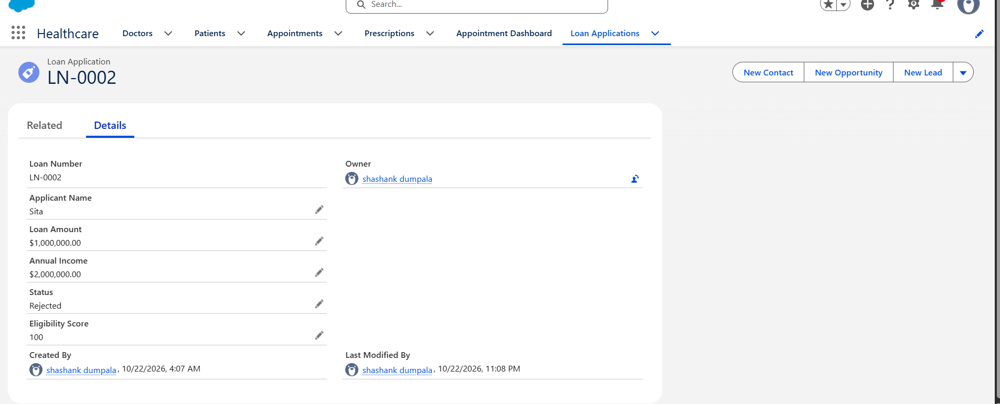

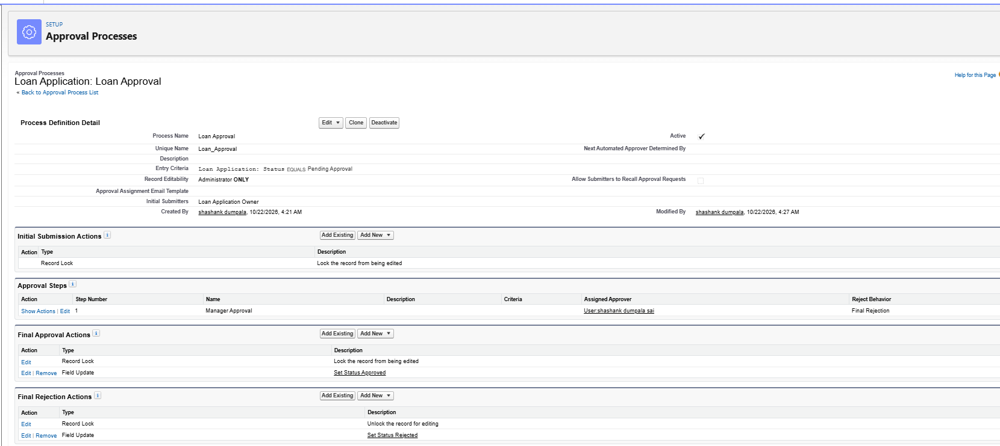

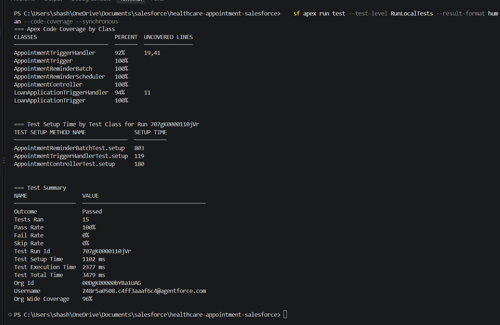

## Author
shashank dumpala | LinkedIn: https://www.linkedin.com/in/shashank-dumpala-a5b90127b